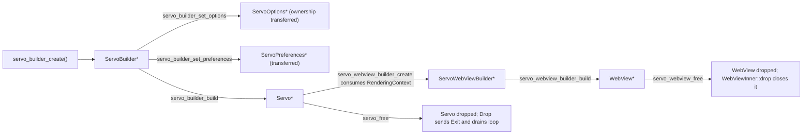

# Servo Embedding Architecture

This document describes how Servo can be embedded in a host application through the
C ABI layer, from the host application down to the engine subsystem threads and the
rendering backend. It is grounded in the code that exists in this repository today and
calls out the pieces that are planned but not yet implemented.

> Audience: engineers implementing the C API (`ffi/capi`), language bindings, and host
> embedders. For the compatibility contract, see [`ABI_STABILITY.md`](./ABI_STABILITY.md).
> For the plan to reach feature parity with CEF-class embedders, see
> [`ROADMAP.md`](./ROADMAP.md).

## 1. Layer stack

Servo is a Rust-first engine. The C ABI is a thin, hand-written wrapper over the public
Rust API in `components/servo` (the `servo` crate, historically called *libservo*). The
C ABI does **not** re-implement engine behavior; it converts C values to Rust values,
calls into the Rust API, and converts results back.

```
+---------------------------------------------------------------+
| Host application (C/C++/other language)                        |
|  - owns the OS window / event loop / GL context                |
+---------------------------------------------------------------+
                |  C ABI (servo/servo_capi.h, libservo_capi.so/.dylib/.dll)
                v
+---------------------------------------------------------------+
| ffi/capi  (crate `servo-capi`, cdylib)                         |
|  - opaque handles, ownership rules, callbacks + user_data      |
|  - one module per Rust object: builder, servo, webview,         |
|    rendering_context, options, preferences, webview_delegate,   |
|    javascript (planned)                                         |
+---------------------------------------------------------------+
                |  Public Rust API (crate `servo`, components/servo)
                v
+---------------------------------------------------------------+
| components/servo  (Servo, WebView, WebViewBuilder, delegates)  |
|  - orchestrates engine subsystems and the embedder's event loop |
+---------------------------------------------------------------+
                |  message channels (crossbeam / ipc_channel) + shared threads
                v
+---------------------------------------------------------------+
| Engine subsystems                                               |
|  Constellation | Script | Layout | Network/Resource | Storage | |
|  DevTools | Profiler | Media | Paint/Compositor | WebRender      |
+---------------------------------------------------------------+
                |  WebRender display lists -> GL/GLES
                v
+---------------------------------------------------------------+
| RenderingContext (Window / Offscreen / Software)                |
|  - surfman + OpenGL/GLES; present() swaps/blits buffers         |
+---------------------------------------------------------------+
```

Key files:

| Layer | Path |
| --- | --- |
| C ABI library root | `ffi/capi/lib.rs` (`servo-capi`, `crate-type = ["cdylib"]`) |
| C ABI `Servo` / builder | `ffi/capi/lib.rs`, `ffi/capi/servo.rs` |
| C ABI `WebView` / builder | `ffi/capi/webview.rs` |
| C ABI delegates | `ffi/capi/webview_delegate.rs` |
| C ABI rendering context | `ffi/capi/rendering_context.rs` |
| C ABI options / preferences | `ffi/capi/options.rs`, `ffi/capi/preferences.rs` |
| Generated C header config | `ffi/capi/cbindgen.toml` (emits `servo/servo_capi.h`) |
| Rust API entry points | `components/servo/lib.rs` |
| `Servo` implementation | `components/servo/servo.rs` |
| `WebView` implementation | `components/servo/webview.rs` |
| Delegate traits | `components/servo/webview_delegate.rs`, `servo_delegate.rs`, `clipboard_delegate.rs`, `gamepad_delegate.rs` |
| Shared embedder types | `components/shared/embedder` (crate `embedder_traits`) |
| Rendering contexts | `components/shared/paint/rendering_context.rs` |
| Custom protocols | `components/servo/lib.rs` (`protocol_handler` module) |
| Reference embedder | `ports/servoshell` |
| C API tests | `tests/capi` (crate `servo-capi-tests`) |

## 2. Object model and ownership

### 2.1 Opaque handles

Every object exposed across the boundary is an **opaque C struct** whose internal layout
is never visible to the embedder. cbindgen is configured (`ffi/capi/cbindgen.toml`) to
emit forward declarations for handles marked `// cbindgen:opaque`:

| C type | Rust type | Created by | Freed / consumed by |
| --- | --- | --- | --- |
| `ServoBuilder` | `ffi/capi::ServoBuilder` | `servo_builder_create` | `servo_builder_build` (consumes) or `servo_builder_free` |
| `ServoOptions` | alias of `servo::Opts` (`// cbindgen:no-export`) | `servo_options_create` | `servo_builder_set_options` (consumes) or `servo_options_free` |
| `ServoPreferences` | alias of `servo::Preferences` (`// cbindgen:no-export`) | `servo_preferences_create` | `servo_builder_set_preferences` (consumes) or `servo_preferences_free` |
| `RenderingContext` | `ffi/capi::RenderingContext` | `servo_rendering_context_create_software`, `servo_rendering_context_create_window` (and planned `_offscreen`) | `servo_webview_builder_create` (consumes) or `servo_rendering_context_free` |
| `ServoWebViewBuilder` | `ffi/capi::ServoWebViewBuilder` | `servo_webview_builder_create` | `servo_webview_builder_build` (consumes) or `servo_webview_builder_free` |
| `Servo` | `servo::Servo` (a raw pointer to the Rust handle) | `servo_builder_build` | `servo_free` |
| `WebView` | `servo::WebView` | `servo_webview_builder_build` | `servo_webview_free` |
| `ServoEventLoopWaker` | plain `#[repr(C)]` value | caller-constructed | copied into the builder by value |

Each handle is a thin `Box` around a Rust value (`Box::into_raw` / `Box::from_raw`). The
Rust `Servo` and `WebView` are themselves cheap, cloneable *handles* over
`Rc<ServoInner>` / `Rc<RefCell<WebViewInner>>` (`components/servo/servo.rs`,
`components/servo/webview.rs`), so the C-level pointer owns one Rust handle rather than
the engine itself.



### 2.2 Builder-to-object transitions

Builders are the only way to create engine objects, mirroring the Rust builders:

- `servo::ServoBuilder` (`components/servo/servo.rs`) has `opts`, `preferences`,
  `event_loop_waker`, `protocol_registry`, and `build()`.
- `servo::WebViewBuilder` (`components/servo/webview.rs`) has `new(servo, rendering_context)`,
  `delegate`, `url`, `hidpi_scale_factor`, `user_content_manager`, `clipboard_delegate`,
  `gamepad_delegate`, and `build()`.

The transition is "consume the builder, return a new object". After
`servo_builder_build` / `servo_webview_builder_build` the builder pointer must not be
used or freed again.

> **Audit note (Phase 0):** `servo_webview_builder_build` and the `_free` functions
> reclaim the builder with `Box::from_raw`. `servo_builder_build` (`ffi/capi/lib.rs`)
> takes `&mut *builder`, moves out `options`/`preferences`, but never reclaims the
> builder allocation with `Box::from_raw`. This is a latent leak that contradicts the
> documented ownership contract and should be fixed as part of the panic/ownership
> audit.

### 2.3 Raw-pointer / `Box` lifecycle

- `*_create` functions do `Box::into_raw(Box::new(value))` and return the raw pointer.
- `*_free` functions do `unsafe { let _ = Box::from_raw(ptr); }`, running `Drop`.
- "Consuming" setters/builders take ownership: they `Box::from_raw` the incoming pointer
  (or `.take()` it out of an owning field) and must not be freed by the caller.
- Non-consuming functions take `&*ptr` for the duration of the call only; the pointer
  remains valid and owned by the caller.

Because the Rust handles are `Rc`-based and **not** `Send`/`Sync`, a raw pointer to a
`Servo`/`WebView` must never be shared across threads. The C-level `Box` wrapper does not
change that.

### 2.4 Callbacks and `user_data`

Callbacks are plain C function pointers plus an opaque `user_data` pointer, copied
**by value** into a `#[repr(C)]` struct. Examples:

- `ServoEventLoopWaker { wake_callback }` — implements `servo_api::EventLoopWaker`
  (`ffi/capi/lib.rs`).
- `ServoWebViewDelegate { user_data, notify_load_status_changed, notify_url_changed,
  notify_page_title_changed, notify_new_frame_ready, notify_closed }` — implements
  `servo_api::WebViewDelegate` (`ffi/capi/webview_delegate.rs`).
- Screenshot completion: `servo_webview_take_screenshot(webview, callback, user_data)`
  (`ffi/capi/webview.rs`).

Contract, consistently documented in the source:

- A non-null function pointer must match the exact C ABI signature, remain valid for as
  long as the delegate is associated with the object, and must never unwind across the
  FFI boundary.
- `user_data` is owned by the embedder; its lifetime must outlast association (or the
  pending async operation).
- Callbacks are invoked **on the embedder's main thread**, from within
  `servo_spin_event_loop` (or an equivalent Rust `Servo::spin_event_loop` call).
  `EventLoopWaker::wake` may be called from *any* Servo-internal thread.

### 2.5 The `WebView` in delegate callbacks is a temporary handle

Delegate callbacks (`WebViewDelegate` impls) receive `webview: WebView` **by value**. The
C ABI turns that into a temporary raw pointer, e.g. in `ffi/capi/webview_delegate.rs`:

```rust
unsafe { callback(&mut webview as *mut WebView, load_status, self.user_data) };
```

`webview` is a local clone, so the pointer is valid only for the duration of the callback.
The header documentation states the embedder must not retain the handle, must not use it
after the callback returns, and must not pass it to `servo_webview_free` or anything else
that takes ownership. Attempting to do so is a use-after-free / double-free.

> The richer delegates (URL changed, title changed, closed) follow the same rule.

## 3. Threading and the event loop

### 3.1 Main-thread affinity

A single embedder **main thread** owns the `Servo` and all `WebView` handles and drives
everything. `servo_builder_build`, all `servo_webview_*` calls, `servo_spin_event_loop`,
and `servo_free` must be called from that same thread. The Rust handles are `Rc`-based
(`components/servo/servo.rs`, `components/servo/webview.rs`) and therefore neither `Send`
nor `Sync`; there is no synchronization inside them.

Internally Servo spawns and owns the subsystem threads:

- **Script** threads (JS + DOM), **layout**, **network/resource** and **storage**
  threads, the **constellation** (which owns pipelines and navigation), **paint /
  compositor / WebRender**, plus **DevTools**, **profiler**, and media threads.
- `Servo::new` (`components/servo/servo.rs`) sets up the channels and starts the
  constellation and resource/storage threads; `multiprocess` may move script execution
  to child processes (see §8).
- Communication is via message channels. `components/servo/servo.rs` uses
  `crossbeam_channel` for `EmbedderMsg`, `NetToEmbedderMsg`, `ConstellationToEmbedderMsg`,
  and `PaintMessage`; in `multiprocess` mode `ipc_channel` is used for cross-process
  traffic (`servo_base::generic_channel` abstracts over both).

### 3.2 `EventLoopWaker`

`EventLoopWaker` (`components/shared/embedder/lib.rs`, re-exported by `servo`):

```rust
pub trait EventLoopWaker: 'static + Send + Sync {
    fn clone_box(&self) -> Box<dyn EventLoopWaker>;
    fn wake(&self); // may be called from any internal thread
}
```

The embedder supplies one via `servo_builder_set_event_loop_waker`. Whenever an engine
thread wants the embedder to make progress, it sends a message and calls `wake()`. The
embedder's `wake` implementation must arrange for `servo_spin_event_loop` to run on the
main thread (post a message to the OS event loop, signal a condvar, etc.). The reference
embedder shows both a headed (`winit`) and headless implementation in
`ports/servoshell/desktop/event_loop.rs`.

### 3.3 `spin_event_loop`

`servo_spin_event_loop` calls `Servo::spin_event_loop` ->
`ServoInner::spin_event_loop` (`components/servo/servo.rs`). One spin:

1. Drains the `Paint` receiver and calls `paint.handle_messages(...)`.
2. Builds an `EmbedderMessageSelector` (a reusable `crossbeam_channel::Select`) over the
   embedder, net, and constellation receivers and drains them, dispatching each message
   (`handle_embedder_message`, `handle_net_embedder_message`,
   `handle_constellation_embedder_message`).
3. Flushes `pending_handled_input_events` as `InputEventResult::DispatchFailed` and
   notifies `notify_input_event_handled`.
4. Reports a lost backend connection as `ServoError::LostConnectionWithBackend`.
5. Calls `paint.perform_updates()`, re-sends accessibility root nodes for viewport
   changes, sends `notify_new_frame_ready` for webviews needing repaint, drains
   `ServoError`s into the `ServoDelegate`, and garbage-collects dead `WebView` weak
   handles.
6. Returns `false` once shutdown is complete.

`ServoInner::drop` sends `EmbedderToConstellationMessage::Exit` and then spins the loop
(sleeping 500 µs between spins) until shutdown completes, so `servo_free` blocks until
the engine has torn down.

### 3.4 Delegate callback dispatch

Delegate callbacks are **not** invoked at the point the engine produces the event. The
engine sends messages; the main thread translates them into delegate calls while
spinning:

| Engine message | Delegate call | Site |
| --- | --- | --- |
| `EmbedderMsg::ChangePageTitle` | `WebViewDelegate::notify_page_title_changed` | `components/servo/webview.rs::set_page_title` |
| `ConstellationToEmbedderMsg::HistoryChanged` | `notify_url_changed` + `notify_history_changed` | `components/servo/webview.rs::set_history` |
| `EmbedderMsg::NotifyLoadStatusChanged` | `notify_load_status_changed` | `components/servo/webview.rs::set_load_status` |
| `ConstellationToEmbedderMsg::FinishJavaScriptEvaluation` | JS eval completion callback | `components/servo/javascript_evaluator.rs::finish_evaluation` |
| new-frame bookkeeping | `notify_new_frame_ready` | `components/servo/servo.rs::send_new_frame_ready_messages` |

Because a delegate callback runs while the main thread is executing a borrow of internal
state, the Rust API is careful not to call delegates while a `RefCell` (notably `Paint`)
is borrowed. See `resend_accessibility_root_nodes_for_viewport_changes` and
`note_accessibility_viewport_changed`, which defer accessibility work to the event loop to
avoid re-entrant borrows.

### 3.5 `RefreshDriver` and vsync

By default Servo drives frame scheduling with a timer. An embedder that can observe vsync
may implement `RefreshDriver` (`components/shared/embedder/lib.rs`):

```rust
pub trait RefreshDriver {
    fn observe_next_frame(&self, start_frame_callback: Box<dyn Fn() + Send + 'static>);
}
```

A `RenderingContext` returns its `RefreshDriver` via `RenderingContext::refresh_driver()`
(`components/shared/paint/rendering_context.rs`). The reference vsync implementation is
`VsyncRefreshDriver` in `ports/servoshell/egl/app.rs`. When no driver is supplied, the
default timer-based driver is used.

```mermaid
sequenceDiagram
    participant Host as Host main thread
    participant Waker as EventLoopWaker (host)
    participant Servo as Servo::spin_event_loop
    participant Threads as Engine threads
    Threads->>Waker: send(msg); wake()
    Waker->>Host: post OS event
    Host->>Servo: servo_spin_event_loop()
    Servo->>Servo: drain Paint + embedder/net/constellation msgs
    Servo-->>Host: delegate callbacks (WebViewDelegate/ServoDelegate)
    Servo->>Servo: paint.perform_updates()
    Servo-->>Host: notify_new_frame_ready(webview)
    Host->>Host: servo_webview_paint() + present()
```

## 4. Rendering pipeline and rendering contexts

### 4.1 Paint / present flow

The Rust `WebView` documentation (`components/servo/webview.rs`) describes the contract:

1. Servo calls `WebViewDelegate::notify_new_frame_ready` when content changed.
2. The host calls `servo_webview_paint` -> `WebView::paint` ->
   `Paint::render(webview_id)`, which renders into the `RenderingContext`.
3. If the context is double-buffered, the host calls `RenderingContext::present()` to
   swap/blit to the front buffer.

Repainting may also happen without a `notify_new_frame_ready`, e.g. for damage/expose;
the last two steps are sufficient.

### 4.2 Rendering contexts

`RenderingContext` (`components/shared/paint/rendering_context.rs`) abstracts an OpenGL/GLES
context. The public types exported by `servo` are:

| Context | Constructor | Use |
| --- | --- | --- |
| `SoftwareRenderingContext` | `SoftwareRenderingContext::new(PhysicalSize)` | Headless / CI; software GL; read back via `read_to_image`. Wrapped today as `servo_rendering_context_create_software(width, height)`. |
| `WindowRenderingContext` | `WindowRenderingContext::new(display_handle, window_handle, size)` | On-screen, renders entire window surface. Wrapped as `servo_rendering_context_create_window(display_handle, window_handle, width, height)`. |
| `OffscreenRenderingContext` | `WindowRenderingContext::offscreen_context(size)` | Render a sub-region / composited child webview; blits into a parent window context. Wrapped as `servo_rendering_context_create_offscreen(parent, width, height)`. |

The trait also supports `prepare_for_rendering`, `resize`, `make_current`,
`gleam_gl_api`/`glow_gl_api`, `create_texture`/`destroy_texture`, `connection`,
`read_to_image`, and `refresh_driver`. Implementors own the surfman device/context/surface.

The C API exposes all three context types
(`servo_rendering_context_create_software`, `servo_rendering_context_create_window`,
`servo_rendering_context_create_offscreen`, `ffi/capi/rendering_context.rs`).

### 4.3 Screenshots

`servo_webview_take_screenshot` (`ffi/capi/webview.rs`) calls
`WebView::take_screenshot(rect, callback)` (Rust: `components/servo/webview.rs`). Servo
waits until the page is ready (load events, render-blocking resources, fonts, reftest
waits, up-to-date rendering), reads back the `RenderingContext`, and invokes the C callback
with RGBA data valid **only for the duration of the callback**. Errors map to
`ScreenshotCaptureError` (`components/shared/embedder/lib.rs`), exported to C as
`ServoScreenshotCaptureError` with `SERVO_SCREENSHOT_CAPTURE_ERROR_*` constants.

## 5. Messaging and interop

### 5.1 Embedder -> engine: input events

`embedder_traits::InputEvent` (`components/shared/embedder/input_events.rs`) is the
input vocabulary: `EditingAction`, `Gamepad`, `Ime`, `Keyboard`, `MouseButton`,
`MouseLeftViewport`, `MouseMove`, `Touch`, `Wheel`. `WebView::notify_input_event`
(`components/servo/webview.rs`) wraps it in an `InputEventAndId` and either:

- routes pointed events through `Paint` for hit-testing, or
- sends `EmbedderToConstellationMessage::ForwardInputEvent` directly to script.

The returned `InputEventId` is later reported via
`WebViewDelegate::notify_input_event_handled` with an `InputEventResult` (`DefaultPrevented`,
`Consumed`, `DispatchFailed`). This lets the host bubble unhandled events to surrounding UI.
The C API does not expose input forwarding yet (Phase 2).

### 5.2 Engine -> embedder: delegate callbacks

The `WebViewDelegate` trait (`components/servo/webview_delegate.rs`) is large and rich:
navigation/permission requests, URL/title/status/favicon/load-status/cursor changes,
history changes and traversal completion, new-frame-ready, input-event handled, crashes,
media session, fullscreen, notifications, console messages, resource interception,
embedder controls (dialogs, `<select>`, color picker, file picker, IME, context menu),
bluetooth, authentication, and accessibility tree updates. `ServoDelegate`
(`components/servo/servo_delegate.rs`) handles process-wide notifications (errors, DevTools
startup/authorization, resource loads not tied to a webview, notifications, console).
`ClipboardDelegate` and `GamepadDelegate` are per-`WebView`.

The C ABI currently exposes `notify_load_status_changed`, `notify_new_frame_ready`,
`notify_url_changed`, `notify_page_title_changed`, and **new on this branch**:
`notify_load_started`, `notify_load_ended`, `notify_load_error`,
`notify_cursor_changed`, `notify_status_text_changed`, `notify_favicon_changed`,
`show_console_message`, and `notify_closed`. Expanding this surface further is Phase 1/2 work.

### 5.3 JavaScript evaluation

Rust: `WebView::evaluate_javascript(script, callback)`
(`components/servo/webview.rs`) -> `JavaScriptEvaluator::evaluate`
(`components/servo/javascript_evaluator.rs`) -> `EmbedderToConstellationMessage::EvaluateJavaScript`.
Results come back as `ConstellationToEmbedderMsg::FinishJavaScriptEvaluation` and are
matched to the pending callback by `JavaScriptEvaluationId`. The result is
`Result<JSValue, JavaScriptEvaluationError>`.

The planned C API adds a callback that serializes `JSValue` to JSON (with an error code on
failure), backed by a new `ffi/capi/javascript.rs` module. See `ROADMAP.md` Phase 1.

### 5.4 Native <-> JS messaging (missing)

There is **no** native-to-JS / JS-to-native message router in either the Rust API or the C
API today. There is no `window.postMessage`-style bridge or `ScriptMessageHandler`
equivalent. `UserContentManager` (`components/servo/user_content_manager.rs`) can inject
user scripts and stylesheets, and `UserScript` is re-exported by `servo`, but that is
injection, not bidirectional messaging. A message router is Phase 4 work.

## 6. Navigation, history, permissions, dialogs, and controls

### 6.1 Navigation and session history

- `WebView::load` / `load_request` send `EmbedderToConstellationMessage::LoadUrl`.
- `WebView::reload` sends `Reload`; `can_go_back`/`can_go_forward` inspect a locally
  cached `back_forward_list`; `go_back`/`go_forward` send `TraverseHistory` with a
  `SessionHistoryTraversalRequest` and return a `TraversalId`.
- `WebView::clear_session_history` sends `ClearSessionHistory`.
- The constellation pushes `HistoryChanged(new_list, index)`; `WebView::set_history`
  updates the cache and fires `notify_url_changed` + `notify_history_changed`.
- `notify_traversal_complete` is fired on `HistoryTraversalComplete`.

The planned C API adds `can_go_back`/`can_go_forward`, `go_back`/`go_forward`, `reload`,
`url`, `load_status`, page-title, and `clear_session_history` accessors, plus delegate
callbacks for URL/title changes.

### 6.2 Permissions, dialogs, and embedder controls

Engine messages are translated into request objects that the embedder resolves:

- Navigation: `ConstellationToEmbedderMsg::AllowNavigationRequest` ->
  `WebViewDelegate::request_navigation` with a `NavigationRequest` (`allow`/`deny`;
  auto-allows on drop).
- Unload: `request_unload` with `AllowOrDenyRequest`.
- Permissions: `EmbedderMsg::PromptPermission` / `RequestWakeLockPermission` ->
  `request_permission` with a `PermissionRequest`.
- Protocol handlers: `AllowProtocolHandlerRequest` -> `request_protocol_handler` with a
  `ProtocolHandlerRegistration`.
- HTTP auth: `NetToEmbedderMsg::RequestAuthentication` -> `request_authentication`.
- Dialogs and form controls: `ShowSimpleDialog`, `ShowEmbedderControl` ->
  `show_embedder_control` with an `EmbedderControl` (`SelectElement`, `ColorPicker`,
  `FilePicker`, `InputMethodControl`, `SimpleDialog`, `ContextMenu`). Each has an id and a
  submit/dismiss; `Drop` sends a default response so requests never hang.
- Window/geometry: `request_move_to`, `request_resize_to`, `screen_geometry`.

All request objects (`NavigationRequest`, `AllowOrDenyRequest`, `AuthenticationRequest`,
`WebResourceLoad`, `SelectElement`, `ColorPicker`, `FilePicker`, `ContextMenu`,
`SimpleDialog`, `GamepadHapticEffectRequest`, `StringRequest`) use a
respond-once-or-`Drop`-default pattern (`components/servo/responders.rs`, and per-type
`Drop` impls) so a forgotten response cannot deadlock the engine. This is the pattern any
new C request API should preserve.

### 6.3 Custom protocols

`components/servo/lib.rs` exposes a `protocol_handler` module re-exporting
`ProtocolHandler`/`ProtocolRegistry` from `net::protocols`, along with fetch/request
types. `ServoBuilder::protocol_registry` installs embedder handlers. The C API does not
expose protocol registration yet (Phase 3).

### 6.4 Site data, network, and injection management

- `SiteDataManager` (`components/servo/site_data_manager.rs`): list/clear cookies,
  localStorage, sessionStorage; has sync and async (callback) variants.
- `NetworkManager` (`components/servo/network_manager.rs`): list/clear the HTTP cache.
- `UserContentManager` (`components/servo/user_content_manager.rs`): add/remove user
  scripts and stylesheets; shareable across webviews; changes apply on reload.

None of these managers are exposed in the C API yet (Phase 3/4).

## 7. Error handling

### 7.1 Today

The C ABI is written defensively at the documented level but is **not panic-safe**:

- Null checks are `assert!`, which panics (and thus aborts at the FFI boundary) rather
  than returning an error code. Examples throughout `ffi/capi/*.rs`.
- Invalid UTF-8 is handled with `.unwrap()` / `.expect(...)` in several setters, e.g.
  `servo_webview_builder_set_url` uses `CStr::from_ptr(url).to_str().unwrap()`.
- Some operations already return sentinels: URL parse failures return `-1`,
  `servo_rendering_context_create_software` returns `NULL` on failure, and preferences
  setters panic on unknown/mistyped preference names.
- A panic inside an `extern "C"` function aborts the process in modern Rust (unwinding
  across an `extern "C"` frame is not allowed). Either way — abort or, historically, UB —
  a host application cannot recover, which is unacceptable for a library.

### 7.2 Desired direction

- **No unwinding across FFI.** Wrap every `extern "C"` entry point in
  `std::panic::catch_unwind` (or a shared helper), returning a documented error code.
  This is the central rule of `ABI_STABILITY.md`.
- **Error codes / result structs / null returns** instead of `assert!`:
  - functions that can fail return an `int32_t` status (`0` success, negative error), or
  - a versioned result struct carrying a status + out-params, or
  - a `NULL` pointer for object-construction failure, with a separate
    `servo_last_error()`-style accessor considered later.
- **Null-safety**: treat null pointers as invalid arguments and return an error rather
  than aborting (once the C API stabilizes; today they `assert!`).
- Keep the `Drop`-default responder pattern so unresolved engine requests degrade
  gracefully.

## 8. Comparison with CEF's process model

CEF is built around a multi-process architecture: a browser process coordinating separate
renderer processes (one or more, often one per site), a GPU process, and utility
processes, communicating over IPC (Mojo). The CEF C/C++ API exposes a large struct-per-
interface ABI with per-struct versioning (`struct_size`/`api_hash`). By contrast:

| Aspect | CEF | Servo today |
| --- | --- | --- |
| Default process model | Multi-process (browser + renderer(s) + GPU) | **Single process** by default; equal in one process |
| Multi-process | Core architecture | Optional: compile with the `multiprocess` feature and set `ServoOptions`/`Opts::multiprocess`; content runs in child processes over `ipc_channel`, with a `gaol` sandbox on supported Linux targets (`components/servo/servo.rs::run_content_process`, `create_sandbox`) |
| API language | C API + C++ wrappers, `RefCounted` handles | C ABI over Rust; opaque handles, `Box` ownership |
| Threading | Browser UI thread + IO + renderer threads; ref-counted handles usable across threads | One embedder main thread owns `Rc`-based, non-`Send` handles; engine threads are internal |
| Versioning | `CEF_VERSION` macros + struct size/api hash | Not yet formalized (proposed in `ABI_STABILITY.md`) |
| Input/rendering | CEF owns the message pump and OSR/windowed rendering | Embedder owns the event loop, window/GL context, and calls `spin_event_loop`/`paint`/`present` |

Implications for the C API:

- The `multiprocess` feature moves script execution to child processes but the **public
  embedding model stays single-main-thread**; C embedders still drive one event loop.
- Because handles are `Rc`-based, the ABI must document strict thread affinity; there is
  no cross-thread refcounting equivalent to CEF's `base::RefCountedThreadSafe` yet
  (reference-counted, thread-safe handles are Phase 5 work in `ROADMAP.md`).
- Where CEF owns the pump and window, Servo delegates wholly to the embedder; the C API
  therefore has more "host owns the platform object" surface (event loop waker, rendering
  context, screen geometry) and less "engine owns the process" surface.

### 8.1 Multi-process bootstrap for C embedders (P1 #14)

When the `multiprocess` feature is enabled, Servo supports running content (script,
layout, paint) in separate **content processes**. The C API exposes two functions
for content-process bootstrap (guarded by `#[cfg(feature = "multiprocess")]`):

| Function | Purpose |
| --- | --- |
| `servo_run_content_process(token)` | Entry point for a content process. Connects to the browser process via the IPC `token`, receives configuration, enters the sandbox (if enabled), and runs the content event loop. Never returns. |
| `servo_create_sandbox()` | Creates and activates the platform sandbox profile. Called automatically by `servo_run_content_process` when `Opts::sandbox` is true, but can be invoked manually for custom initialization order. Returns `true` on success, `false` if sandboxing is unsupported on the current platform. |

**Launch flow:**

1. **Browser process** (embedder's main process) creates a `Servo` with
   `servo_options_set_multiprocess(true)` and `servo_options_set_sandbox(true)`.
   Internally, `ServoBuilder::build` creates an `IpcOneShotServer` and generates
   a connection token.

2. **Embedder** retrieves the token (currently via Rust API; a C accessor is
   planned) and launches N content processes as children, passing the token
   via command line (`--content-process <token>`) or environment variable
   (`SERVO_CONTENT_TOKEN`).

3. **Each content process** executes a minimal `main()` that calls
   `servo_create_sandbox()` followed by `servo_run_content_process(token)`.
   The content process then runs until the browser process terminates it.

**Sandbox support matrix:**

| Platform | Sandbox | Notes |
| --- | --- | --- |
| Linux (x86_64) | `gaol` (seccomp-bpf + namespaces) | Requires `multiprocess` feature; `servo_create_sandbox()` returns `true`. |
| macOS (x86_64/arm64) | `sandbox-exec` (Seatbelt) | Requires `multiprocess` feature; `servo_create_sandbox()` returns `true`. |
| Windows | None | `servo_create_sandbox()` returns `false`; content runs unsandboxed. |
| iOS / Android / OHOS | N/A | Multi-process not supported. |
| ARM / RISC-V (Linux) | None | `gaol` not available; `servo_create_sandbox()` returns `false`. |

The embedder is responsible for process lifecycle management (crash detection,
restart, resource limits). No zygote/fork-server abstraction is provided.

## See also

- [`ABI_STABILITY.md`](./ABI_STABILITY.md) — versioning, symbol naming, panic policy,
  ownership/threading contract templates.
- [`ROADMAP.md`](./ROADMAP.md) — phased plan and backlog.
- `ffi/capi/README.md`, `tests/capi/README.md` — crate-level notes and test harness.
- `ports/servoshell` — reference embedder implementations (headed, headless, EGL/Android,
  OHOS).
