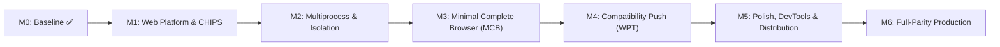

# Blink / CEF vs Servo Parity Matrix

Status: **Living Document** · Target: Full Browser Engine (Blink/CEF Parity, iOS Deferred)
Companion docs: [`FULL_BROWSER_ROADMAP.md`](FULL_BROWSER_ROADMAP.md), [`CEF_PARITY.md`](CEF_PARITY.md), [`SECURITY_AUDIT.md`](SECURITY_AUDIT.md), [`PRODUCTION_READINESS.md`](PRODUCTION_READINESS.md).

---

## 1. Executive Summary

This matrix tracks the convergence of Servo from an embeddable rendering engine toward a full, all-purpose browser engine comparable to Blink/Chromium/CEF, as structured by the [Servo Full Browser Roadmap](FULL_BROWSER_ROADMAP.md).

Status definitions:
- **Done / Parity**: Implemented, verified, and active in CI/production paths.
- **In Progress**: Active implementation or partial support present.
- **Planned**: Scoped in roadmap milestones (M1–M6) with concrete design.
- **Deferred**: Explicitly non-blocking for current browser milestones (e.g., iOS support deferred).

---

## 2. Core Feature Parity Matrix

### 2.1 Process Model & Site Isolation

| Capability | Blink / Chromium / CEF | Servo Current State | Servo Target | Status | Milestone | Evidence / Citation |
|---|---|---|---|---|---|---|
| Multiprocess Architecture | Default multi-process (Browser, Renderer, GPU, Network, Utility) | Multiprocess optional (`--multiprocess`), C API bootstrap enabled (`servo_multiprocess_init`) | Default multiprocess architecture with separated browser & content pipelines | In Progress | M2 | `components/constellation/constellation.rs`, `ffi/capi/lib.rs` |
| Sandboxing (Linux) | Seccomp-bpf, namespaces, chroot | Gaol / seccomp-bpf supported on x86_64 | Multi-arch seccomp-bpf enabled by default | In Progress | M2 | `components/constellation/sandboxing.rs` |
| Sandboxing (macOS) | Seatbelt / macOS sandbox profile | Gaol sandbox supported on x86_64 | Supported across x86_64 and arm64 | In Progress | M2 | `components/servo/servo.rs:create_sandbox` |
| Sandboxing (Windows) | AppContainer / Restricted Tokens / Job Objects | In-process mitigation policies (DEP, ASLR, strict handles, extension points) + Job Object containment (`active_process_limit = 1`) | Full AppContainer / Restricted Token containment | In Progress | M2 | `components/servo/servo.rs`, `docs/embedding/WINDOWS_SANDBOX_DESIGN.md` |
| Sandboxing (Android) | Isolated processes via `android:isolatedProcess` | Log honesty / capability published, isolated service prototype | Android isolated renderer process | In Progress | M2 | `docs/embedding/ANDROID_EMBEDDING_GUIDE.md` |
| Sandboxing (iOS) | WebKit out-of-process isolation | Non-functional / Unsupported | Deferred | Deferred | Deferred | `docs/embedding/IOS_PORT_SPIKE.md` |
| Site Isolation | Out-of-process iframes (OOPIF), origin/site-keyed renderer processes | Origin-keyed process & event loop pooling active via `opts.origin_isolation` (`--origin-isolation`, `servo_options_set_origin_isolation`) and registrable domain pooling | Per-site / per-origin content process isolation | In Progress | M2 | `components/constellation/constellation.rs`, `components/config/opts.rs`, `SITE_ISOLATION_DESIGN.md` |

---

### 2.2 Web Platform Compatibility (WPT)

| Subsystem | Blink / CEF Support | Servo Current State | Servo Target | Status | Milestone | Evidence / Citation |
|---|---|---|---|---|---|---|
| HTML / DOM Living Standard | >99% WPT pass rate | Core DOM, Events, MutationObservers, Web Components (v1 partial) | Full DOM / Shadow DOM / HTML5 conformance | In Progress | M1/M4 | `tests/wpt/meta/html`, `tests/wpt/meta/dom` |
| CSS Layout & Formatting | Complete CSS 2.1, Flexbox, Grid, Subgrid, Container Queries | Flexbox, Grid, Float, Positioning, Multicol; partial subgrid/container | Complete modern CSS layout engine | In Progress | M1/M4 | `tests/wpt/meta/css` |
| CSS Animations & Transforms | 2D/3D Transforms, Transitions, Web Animations API | 2D/3D transforms, basic transitions/animations | Complete WAAPI and GPU-accelerated composites | In Progress | M4 | `components/layout/animation.rs` |
| JavaScript / WebAssembly | V8 (ESNext, Wasm SIMD/threads, GC) | SpiderMonkey (ESNext, Wasm basic/threads) | SpiderMonkey up-to-date, JIT enabled on all desktop platforms | Parity | M1 | `components/script/dom/bindings` |
| Fetch & Streams | WHATWG Fetch, ReadableStream, WritableStream, TransformStream | WHATWG Fetch spec conformance (header list get null-check + zero-copy fast-path, CORS retain), Streams ongoing | Full Streams spec conformance | In Progress | M1 | `components/shared/net/fetch/headers.rs`, `components/net/fetch/`, `components/script/dom/readablestream.rs` |
| Storage & IndexedDB | IndexedDB 3.0, LocalStorage, SessionStorage, Cache API | LocalStorage/SessionStorage functional, IndexedDB partial | Full IndexedDB and Cache Storage compliance | In Progress | M4 | `tests/wpt/meta/IndexedDB` |
| Web Workers & Service Workers | Dedicated, Shared, and Service Workers | Dedicated workers functional, Service Workers partial | Full Service Worker & offline caching support | In Progress | M4 | `tests/wpt/meta/service-workers` |
| WebGL & WebGPU | WebGL 1/2, WebGPU fully shipping | WebGL 1/2 functional via glow/angle, WebGPU prototype via wgpu | Hardened WebGL 2 & WebGPU across desktop/mobile | In Progress | M4 | `docs/embedding/GRAPHICS_AND_WEBGPU_STATUS.md` |
| Media & Audio | HTMLMediaElement, WebAudio, WebRTC, MSE | GStreamer-backed media playback; WebAudio partial | Seamless HTML5 video/audio + WebAudio parity | In Progress | M4 | `docs/embedding/MEDIA_AND_DRM_DESIGN.md` |
| WebRTC | PeerConnection, DataChannel, MediaStream | WebRTC PeerConnection, DataChannel, and ICE negotiation implementation active across `components/script/dom/webrtc` and `components/media/webrtc` | Full real-time audio/video communications | In Progress | M4 | `components/script/dom/webrtc/`, `components/media/webrtc/` |

---

### 2.3 Security & Privacy Hardening

| Feature | Blink / CEF Support | Servo Current State | Servo Target | Status | Milestone | Evidence / Citation |
|---|---|---|---|---|---|---|
| Content Security Policy (CSP) | Full CSP Level 3 | Functional via external `content-security-policy` crate | Full CSP 3 + reporting API | Parity | M0/M1 | `components/net/fetch/methods.rs`, `SECURITY_AUDIT.md` §3 |
| CORS & Preflights | Complete Fetch CORS algorithm | Functional, unit and WPT verified | Complete Fetch CORS parity | Parity | M0 | `components/net/cors_cache.rs` |
| Mixed Content | Mixed content blocking (active & passive) | Target-browsing-context (step 1.4) enforced | Complete spec compliance with configurable policies | Parity | M0 | `components/net/fetch/methods.rs`, commit `aed70287661` |
| SameSite Cookies | SameSite=Lax by default, Strict/None enforcement | Enforced on cross-site requests & navigations | Full SameSite spec parity | Parity | M0 | `components/net/cookie.rs`, `SECURITY_AUDIT.md` §4.3 |
| Partitioned Cookies (CHIPS) | Opt-in `Partitioned` cookies keyed by top-level site | Storage keying and top-level partition key derivation active | Full CHIPS send/receive partitioning | Parity | M0/M1 | `components/net/http_loader.rs:435`, `components/net/tests/cookie.rs` |
| CORP / COEP / COOP | Cross-origin isolation enforced | CORP and COEP creds enforced; COOP browsing context switch stubbed | Full cross-origin isolation and browsing context group swapping | In Progress | M2 | `components/net/http_loader.rs:2094`, `SECURITY_AUDIT.md` §3 |
| X-Content-Type-Options | `nosniff` blocks script/style MIME mismatches | Implemented and verified via `determine_nosniff` | Full nosniff parity | Parity | M0 | `components/shared/net/fetch/headers.rs:287` |
| Certificate Overrides | Per-host exception dialogs & HSTS pinning | Global ignore option + DER-based override manager | Per-host exception model with strict HSTS adherence | In Progress | M1 | `components/net/connector.rs`, `SECURITY_AUDIT.md` §5 |

---

### 2.4 Consumer Browser Experience (MCB)

| Feature | Standard Browser | Servo Current State | Servo Target | Status | Milestone | Evidence / Citation |
|---|---|---|---|---|---|---|
| Tab Management | Multi-tab UI, tab switching, close/pin | Multi-tab strip UI, tab switching, close button, `+` new tab, `⊞` new window, and keyboard shortcuts (`Ctrl+T` new tab, `Ctrl+W` close tab, `Ctrl+N` new window) | Tabbed browser shell using embedding API | Parity | M3 | `ports/servoshell/window.rs`, `ports/servoshell/desktop/gui.rs` |
| Navigation Controls | Back, Forward, Reload, Stop, History dropdown | Back, Forward, Reload, Stop, and History traversal context menus wired across engine, C API (`servo_webview_get_history_count/index`, `servo_webview_traverse_history`, `servo_webview_stop`), and UI toolbar | Full navigation controls with session history traversal | Parity | M0/M3 | `components/servo/webview.rs`, `ffi/capi/webview.rs`, `ports/servoshell/desktop/gui.rs` |
| Omnibox & URL Bar | URL input, search engine query, suggestions | Interactive location bar with URL fixing, domain resolution & search fallback; `about:X` alias forwarding (`about:about`, `about:history`, `about:downloads`, `about:settings`, `about:config`); `servo:settings` privileged protocol; persistent history storage | Full omnibox with auto-complete and search suggestions | Parity | M3 | `ports/servoshell/parser.rs:location_bar_input_to_url`, `ports/servoshell/desktop/protocols/servo.rs`, `ports/servoshell/running_app_state.rs` |
| Download Manager | Progress UI, pause/resume, safety checks | C API download callbacks (`servo_download_item_*`), shell delegate tracking (`on_before_download`, `on_download_updated`), `servo:downloads` internal page, toolbar download button (📥), and `Ctrl+J` shortcut | Complete download shelf/manager UI with resume | Parity | M3 | `ffi/capi/download.rs`, `ports/servoshell/running_app_state.rs`, `ports/servoshell/desktop/protocols/servo.rs`, `ports/servoshell/desktop/gui.rs` |
| Bookmarks & History | Persistent SQLite/JSON storage, manager UI | Persistent JSON history (`history.json`) and bookmarks (`bookmarks.json`) stores, toolbar bookmark button (★) and Ctrl+D shortcut, session history traversal with right-click toolbar menus, and `servo:history` / `servo:bookmarks` internal pages | Persistent bookmarks and browsing history store | Parity | M3 | `ports/servoshell/running_app_state.rs`, `ports/servoshell/desktop/protocols/servo.rs`, `ports/servoshell/desktop/gui.rs` |
| Profiles & Incognito | User profiles, private browsing, cookie isolation | End-to-end private browsing mode (`WebViewBuilder::private(true)`, `servo_webview_builder_set_private_browsing`, `servo_webview_is_private`), isolated in-memory `private_resource_threads` & `private_storage_threads`, `--incognito` / `--private` CLI flag, and toolbar incognito indicator | Multiple persistent profiles and true private mode | Parity | M3 | `components/constellation/constellation.rs`, `components/servo/webview.rs`, `ffi/capi/webview.rs`, `ports/servoshell/prefs.rs`, `ports/servoshell/desktop/gui.rs` |
| Permissions UI | Geolocation, Camera, Microphone prompts | Interactive permission prompt modal dialog with Allow/Deny controls (Enter/Escape key bindings), and C API `ServoPermissionCallback` (`servo_permission_callback_allow/deny`) | Interactive permission prompt UI | Parity | M3 | `ports/servoshell/desktop/dialog.rs:368-395`, `ffi/capi/permission.rs` |

---

### 2.5 Polish, Observability & Distribution

| Capability | Blink / CEF Support | Servo Current State | Servo Target | Status | Milestone | Evidence / Citation |
|---|---|---|---|---|---|---|
| DevTools | Chrome DevTools Protocol (CDP) server + remote frontend | Remote DevTools protocol server present (`--devtools`) | Full CDP inspection (DOM, Network, Console, Sources) | In Progress | M5 | `components/devtools/`, `W4.4` verified |
| Accessibility | Complete platform accessibility APIs | AccessKit integrated; C API tree updates + action forwarding active (`headed_window.rs:771`) | Full AccessKit screen-reader and action parity | Parity | M0/M5 | `ports/servoshell/desktop/headed_window.rs`, `docs/embedding/ACCESSIBILITY_AND_PRINTING.md` |
| Print to PDF | Headless and interactive PDF printing | C API `servo_webview_print_to_pdf` with `ServoPdfPrintSettings` and C test verification | Headless and interactive PDF export | Parity | M0/M5 | `ffi/capi/printing.rs`, `docs/embedding/ACCESSIBILITY_AND_PRINTING.md` |
| Crash Reporting | Breakpad / Crashpad minidumps, symbolication server | POSIX signal handler backtrace (Linux/macOS) | Native minidump generation + crash telemetry | In Progress | M5 | `docs/embedding/FUZZING_AND_CRASH_TELEMETRY.md` |
| Hang Monitor | Unresponsive script dialog + renderer kill | Background hang monitor on by default (`W5.1`) | Unresponsive page dialog with terminate option | Parity | M0 | `components/script/event_loop/hang_monitor.rs` |
| Packaging & Distribution | Signed MSIX, PKG, DMG, Deb, RPM, Flatpak | CI build artifacts (ZIP/tarballs) | Signed/notarized desktop installers and packages | Planned | M5 | `docs/embedding/PRODUCTION_READINESS.md` |
| Extensions | Manifest v3 extensions (chrome.* APIs) | Native WebExtension loader (Manifest v2 & v3) supporting content scripts, stylesheets, `chrome.runtime` / `browser.runtime` bridge, and `--load-extension` flag | Complete Manifest v3 WebExtensions runtime | In Progress | M6 | `ports/servoshell/desktop/extensions.rs`, `ports/servoshell/desktop/app.rs` |

---

## 3. Milestone Progress Tracker

- **M0 (Baseline)**: C API 0.2.0, Panic bounds, SameSite, Mixed Content, Hang Monitor default-on, WPT baseline tools.
- **M1 (Core Web Stability)**: CHIPS partition key threading, top WPT failures remediation, certificate per-host override.
- **M2 (Multiprocess & Isolation)**: Sandboxing on Windows, AppContainer, Site isolation prototype, COOP/COEP navigation switch.
- **M3 (Minimal Complete Browser)**: Tabbed browser shell, omnibox, download manager, history/bookmarks, private browsing.
- **M4 (Compatibility Push)**: Layout/CSS grid/flexbox improvements, Streams/Workers conformance, WebAudio/Media robustness.
- **M5 (Polish & Distribution)**: Crashpad minidumps, AccessKit action forwarding, Print-to-PDF, signed platform installers.
- **M6 (Full-Parity Readiness)**: Comprehensive WPT pass-rates matching Tier-1 browser engines.
